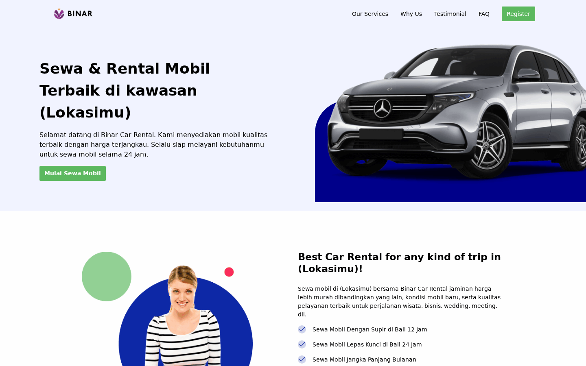
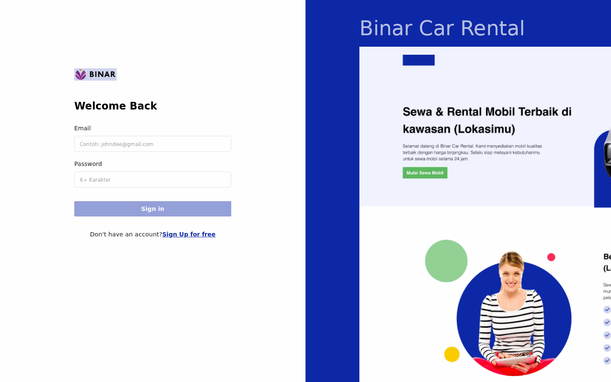

# Binar Car Rental

Binar Car Rental is a car-rental web app for two audiences: customers who
want to find a vehicle, book it, pay, and download an e-ticket, and the admin
who keeps the fleet up to date. A customer lands on a marketing page, filters
the available cars, opens one to book it, pays by bank transfer, and retrieves
a ticket. An admin signs in to a dashboard that charts orders and adds, edits,
or removes cars. Everything happens in the browser — car and order records come
from an external API, not from this repo.



The landing page above ships its text inside the app, so it loads without
waiting on any data service. The search, booking, and admin screens do not:
they need an external API to return cars and orders.

## What you can do

The app splits into a customer side and an admin side. Customers browse and
buy; admins manage the fleet those customers see.

Customers:

- Filter and search rental cars by name, category, price range, and rental status, then open a result (`/search`).
- Read a car's full details before deciding to book it (`/detail/:id`).
- Place an order for a chosen car from the booking section of its detail page (`/detail/:id`).
- Pay for an order by bank transfer, after signing in (`/payment/:id`, then `/transfer/:id`).
- View and download the e-ticket for a completed order (`/eticket/:id`).
- Create a customer account or sign in through the "Welcome Back" / "Sign Up for free" form (`/register`).



Those customer steps form one chain: search returns cars, detail leads to an
order, payment asks for a bank and shows transfer instructions, and the
e-ticket closes the loop. Payment is the only customer step that requires a
sign-in; the others are open to anyone.

Admins:

- Sign in to the protected admin area with the "Welcome, Admin BCR" form (`/admin/login`).
- Review an order-count bar chart and an order table on the dashboard (`/admin`, `/admin/dashboard`).
- List, add, edit, and delete cars in the fleet (`/admin/cars`, `/admin/cars/add`, `/admin/cars/edit/:id`).


## How it works

Binar Car Rental is a browser-only app. A Vite build compiles the JSX into
static files in `dist/`, and nginx serves them with a fallback that sends every
deep link back to `index.html` so client-side routes survive a refresh. There
is no application server to start.

There is also no database in this repo. Axios in the browser calls an external
Binar Academy API for cars, orders, and login; Redux holds transient state in
memory, and a token in the browser's localStorage marks a customer or admin as
signed in. That external API is the app's only backend.

## Running it

Building needs Node 24. Install dependencies and produce the static site with:

```sh
npm ci
npm run build
```

For local development, `npm run dev` starts the Vite server and `npm run lint`
runs ESLint. There is no backend process to launch — the build output is static
files that nginx serves.

Because the API address is hardcoded in the source, search, booking, payment,
and admin actions only work while that external service is reachable.

## Limitations

All car, order, and login data comes from the external
`api-car-rental.binaracademy.org` API. Whether that service is still live is
`UNKNOWN — requires human input`; without it the search, detail, payment, and
admin screens show errors.

Only three screens were captured: the landing page, the customer register/
sign-in form, and the admin login form. Search, detail, order, payment,
transfer, and e-ticket screens need a live API (and payment needs a customer
login); none were exercised. The dashboard and car-management screens need an
admin login and were not captured either.

The admin report is hardcoded to 2023 date windows, so its chart is effectively
frozen to 2023. Auth is client-side only, so its route guards can be bypassed by
navigating directly. Bootstrap styling and placeholder car images come from
external CDNs, so offline use degrades their appearance.

Developer notes — exact locked versions, the auth model, external API wiring,
operational risks, and the container layout — are in
[TECHNICAL.md](TECHNICAL.md).
